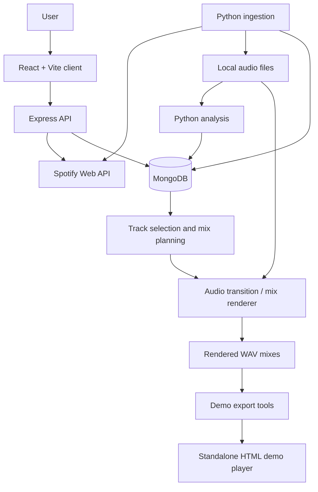

# AutoDJ

**AutoDJ is a locally developed, AI-assisted DJ mixing prototype that analyzes songs, plans musically compatible transitions, and renders multi-track WAV mixes.**

The project combines a React/Express Spotify interface with a Python audio-analysis and mixing pipeline. Rather than simply crossfading songs, its mixing engine considers tempo, harmonic compatibility, musical phrases, energy, vocals, and—when available—separated instrument stems.

> **Status:** Local prototype; not deployed. The Python pipeline includes automatic multi-song mix planning and WAV rendering. The React/Express application supports Spotify login, track search, and Spotify playlist creation; it **does not play or render mixes**. The standalone demo player plays **pre-rendered** files only.

## Features

- **Spotify integration:** OAuth login, track search, and creation of ordered Spotify playlists.
- **Music ingestion:** Import liked-song metadata, find candidate audio sources, and validate durations before local processing.
- **Audio analysis:** Extract BPM, beats/downbeats, key/Camelot information, bar-level energy and bass, and phrase-aligned sections.
- **Compatibility-aware transitions:** Choose songs and transition points based on musical fit.
- **Multiple transition techniques:** Blend, filters, echo, cuts, loops, EQ swaps, vocal handovers, and stem-based techniques.
- **Continuous mixes:** Optimize song order and entry/exit points across a complete chain, time-stretch tracks, and render a mastered WAV.
- **Two mixing modes:** Default EQ-based transitions, or `--stems` for stem-aware transitions combined with EQ (the current development direction).
- **Demo player:** A standalone HTML player for pre-rendered mixes, with optional Gemini-powered chat requiring your own API key.

**Audio availability:** No source recordings, separated stems, or rendered audio are included in this repository. Only code and selected analysis/metadata are committed. To reproduce mixes, you need your own legally accessible music library and must run the analysis pipeline locally.

## Architecture



**Important:** The browser/API and Python renderer are separate paths in the current repository. The diagram does not imply that the web app can initiate a rendered mix today.

### Repository structure

```text
autoDJ/
├── api/
│   ├── index.js                 # Express, Spotify OAuth, session cookie
│   └── routes/playlist.js       # Track ordering and Spotify playlist creation
├── client/
│   └── src/
│       ├── pages/LoginPage.jsx
│       ├── pages/SearchPage.jsx
│       └── UserContext.jsx
├── python/
│   ├── ingest.py                # Spotify library ingestion / audio acquisition
│   ├── analyze.py               # Musical feature extraction
│   ├── auto_dj.py               # Pairwise transition planning
│   ├── render_transition.py     # Audio transition rendering
│   ├── make_mix.py              # Continuous mix planning and rendering
│   ├── stems_scan.py            # Stem analysis
│   ├── lastfm_tags.py           # Genre/tag enrichment
│   ├── export_demo_library.py
│   ├── export_demo_mixes.py
│   ├── requirements.txt
│   └── data/                    # Selected analysis/test data
└── demo/
    ├── player.html              # Standalone demo interface
    ├── library.json
    └── mixes/mixes.js           # Generated mix metadata; audio not committed
```

## Tech stack

| Layer | Technologies |
| --- | --- |
| Frontend | React, Vite, React Router, Axios |
| Backend | Node.js, Express, JWT, Mongoose |
| Data | MongoDB |
| Music services | Spotify Web API, Spotipy, Last.fm tagging |
| Audio analysis | Python, NumPy, librosa, Essentia and supporting analysis scripts |
| Audio rendering | Pedalboard, SciPy, stem-aware mixing and time stretching |
| Audio acquisition | yt-dlp |

The Python requirements file is a **partial dependency list**: some scripts also import packages such as `essentia`, `scipy`, and `pedalboard`, which must be installed separately. Certain workflows may require external audio tools/models and a Linux/WSL environment.

## Getting started

### Prerequisites

The audio pipeline is developed under **Ubuntu 24.04 on WSL2 with an NVIDIA GPU**. Analysis uses **Beat This!**, **Essentia**, and **Demucs**; the Python packages and model checkpoints are not fully provisioned by `requirements.txt`. Use a compatible Python version inside WSL rather than assuming the latest Windows Python release works.

- Node.js and npm
- Python 3 and a virtual environment (Linux/WSL recommended for the audio pipeline)
- MongoDB instance
- Spotify developer application and configured redirect URIs
- FFmpeg and other system-level audio dependencies as required by the chosen workflow
- Access to audio you are legally permitted to process

### 1. Clone the repository

```bash
git clone https://github.com/azibat0r/autoDJ.git
cd autoDJ
```

### 2. Configure the API

Create `api/.env`:

```dotenv
MONGO_URL=your_mongodb_connection_url
SPOTIFY_CLIENT_ID=your_spotify_client_id
SPOTIFY_CLIENT_SECRET=your_spotify_client_secret
REDIRECT_URI=http://127.0.0.1:4000/api/auth/callback
JWT_SECRET=replace_with_a_long_random_secret
```

Register the **exact** `REDIRECT_URI` in your Spotify developer dashboard. Spotify redirect-URI requirements may restrict which local addresses are accepted.

Start the backend:

```bash
cd api
npm install
npm run dev
```

The Express API listens on **port 4000**. Check `http://127.0.0.1:4000/api/test`.

### 3. Start the frontend

In a second terminal:

```bash
cd client
npm install
npm run dev
```

Open the Vite URL (normally `http://localhost:5173`). The client currently configures its API base URL as `http://127.0.0.1:4000`; the OAuth callback redirects to `http://127.0.0.1:5173/search`.

For consistent local authentication, prefer using `127.0.0.1:5173` in the browser. If you change ports or hosts, update the corresponding client and API configuration.

### 4. Configure the Python pipeline (WSL2 / Ubuntu)

Create `python/.env`:

```dotenv
MONGO_URL=your_mongodb_connection_url
SPOTIFY_CLIENT_ID=your_spotify_client_id
SPOTIFY_CLIENT_SECRET=your_spotify_client_secret
SPOTIFY_REDIRECT_URI=http://127.0.0.1:8888/callback
LASTFM_API_KEY=your_lastfm_key_if_using_tag_enrichment
```

Register the Python Spotify redirect URI separately if you use ingestion.

```bash
# Run in Ubuntu / WSL2, from the repository python/ directory
source ~/autodj-env/bin/activate
pip install -r requirements.txt
```

The existing source comments use the WSL environment `~/autodj-env`. This assumes you have already created and provisioned that environment with a compatible Python interpreter, CUDA-enabled PyTorch, Beat This!, Essentia, Demucs, and the remaining rendering dependencies. This repository does not yet provide a complete environment bootstrap script.

**Additional dependencies:** The repository's `requirements.txt` does not capture every Python import. Depending on the script, install and configure Essentia, SciPy, Pedalboard, and other audio/ML tools. The mix renderer has been developed for a Linux/WSL-style environment; this is not yet a fully reproducible one-command installation.

### 5. Ingest and analyze music

From the `python/` directory, with your environment and audio dependencies configured:

```bash
python ingest.py
python analyze.py --limit 10
```

The ingestion script accesses Spotify liked songs and attempts to acquire local audio. Only run this workflow on audio you have the rights to access and process. The analyzer writes song features to MongoDB.

### 6. Render a transition

After songs are ingested and analyzed:

```bash
python auto_dj.py --from "Song A" --to "Song B"
```

Or manually select transition bars and a technique:

```bash
python render_transition.py \
  --from "Song A" \
  --to "Song B" \
  --out-bar 112 \
  --technique blend
```

Track titles must match records in your database. Stem-based techniques require appropriate stem files and metadata.

### 7. Generate a continuous mix

```bash
python make_mix.py --songs 4 --genre amapiano --energy low \
  --out renders/mix/amapiano.wav
```

For a fixed song order:

```bash
python make_mix.py --chain "Song A" "Song B" "Song C" \
  --out renders/mix/three_songs.wav
```

For compatible stem-analyzed songs (**current direction: stems + EQ**):

```bash
python make_mix.py --stems --genre "r&b" --energy low --songs 3 \
  --out renders/mix/rnb_calm.wav
```

These commands depend on a populated MongoDB library and the audio/stem files referenced by its records. Use `python make_mix.py --help` for all available options.

## How mixing works

1. **Analyze tracks:** Estimate rhythmic, harmonic, structural, and energy features.
2. **Find candidates:** Filter by tempo/key compatibility and evaluate plausible phrase-aligned entry and exit points.
3. **Plan the whole sequence:** `make_mix.py` uses a beam-search approach to choose a chain and transition points together, rather than optimizing every pair in isolation.
4. **Render audio:** Time-stretch compatible tracks, apply EQ or stem-aware transitions, and assemble the continuous output.
5. **Master output:** Apply loudness adjustments and final limiting.

The renderer includes multiple techniques, but not every technique is selected automatically in every workflow.

## Demo

The repository includes a standalone demo interface at [`demo/player.html`](demo/player.html), plus generated library and mix metadata. **It does not generate mixes in the browser.** It plays pre-rendered audio files only when those files are supplied locally.

**Audio files are not included in the repository** (`demo/mixes/*.mp3` is gitignored). To publish a playable demo, host only audio you have permission to share, then update the demo assets/paths accordingly.

### Optional Gemini chat

The demo page uses Gemini for its optional AI chat. Create the **gitignored** `demo/config.js` file locally with a placeholder replaced by your own key:

```javascript
window.AUTODJ_GEMINI_KEY = "your_gemini_api_key";
```

Alternatively, the demo can ask for a key in its UI. **Never commit your key.** This is a client-side demo configuration, not a secure production secret-storage design.

### Screenshots

_Add screenshots once you have selected the views you want to showcase._

| Web interface | Demo player |
| --- | --- |
| Screenshot to add | Screenshot to add |

Suggested files: `docs/images/web-app.png` and `docs/images/demo-player.png`. After adding them, replace the placeholders with Markdown image links.

### Audio examples

No public audio samples are provided because current mixes incorporate copyrighted commercial recordings. Listening demonstrations are kept local; any future published samples should use audio cleared for that purpose.

## Evaluation and iteration

Transition quality is evaluated by listening and comparing alternatives, including blind comparisons. The goal is to improve timing, vocal handoffs, and tonal balance; **professional-quality or seamless results are not claimed as established benchmarks**. Quantitative listening-test results can be added here when the test setup and measurements are documented.

## Current limitations and roadmap

- [x] Spotify OAuth and playlist generation
- [x] Audio ingestion and analysis scripts
- [x] Multiple pairwise transition renderers
- [x] Continuous multi-song mix planner and WAV renderer
- [x] Standalone demo player and export scripts
- [ ] Connect the web interface to the Python rendering pipeline
- [ ] Make setup fully reproducible with complete Python/system dependencies
- [ ] Add automated integration and audio-quality tests
- [ ] Add screenshots; publish audio only if distribution rights are secured
- [ ] Improve error handling, background jobs, and production deployment

## Notes on Spotify and copyright

AutoDJ is an independent project and is not affiliated with or endorsed by Spotify. Spotify authentication and playlist features are distinct from locally rendered audio. Spotify access does not grant rights to download, remix, or redistribute recordings. Follow the applicable Spotify developer terms and copyright rules; do not publish copyrighted mix audio without the required permissions.

## Author

Developed by [azibat0r](https://github.com/azibat0r).
